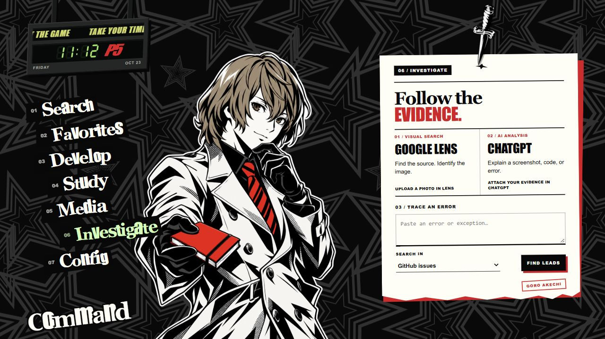

# PHANTOM START

Персональная стартовая страница в стиле Persona 5: чёрно-серые звёзды, персонажи для каждого раздела и записка, которую закрепляет падающий нож.



## Запуск

Скачайте репозиторий и откройте `index.html` в браузере. Сборка и установка зависимостей не нужны. Папка `assets` должна оставаться рядом с HTML-файлом.

Для локальной разработки можно запустить сервер из корня проекта:

```sh
python -m http.server 8877 --bind 127.0.0.1
```

Откройте `http://127.0.0.1:8877/`. После обновления файлов используйте Ctrl+F5.

## Возможности

- Search — поиск Google или переход по адресу сайта.
- Favorites, Develop, Study, Media — сохранённые ссылки и категории.
- Investigate — кабинет Акечи: Google Lens для поиска по изображению, ChatGPT для анализа скриншотов и поиск ошибок в GitHub issues, Stack Overflow или интернете. Фото загружаются на сайте выбранного сервиса; встроенного AI API нет. Текст ошибки отправляется только после FIND LEADS.
- Config — выбор виниловой пластинки: Phantom (Title Screen), Beneath the Mask (instrumental), Layer Cake и Tokyo Daylight. Включение/выключение, громкость и выбранная запись сохраняются; ссылки редактируются здесь же. Enter из меню Config переводит фокус к выбранной пластинке.
- При переключении разделов звучит короткий эффект выбора Persona 5. Музыка по умолчанию выключена, загружается только после включения и ставится на паузу при скрытии вкладки или показе календаря.
- Стрелки переключают разделы, `/` открывает поиск, Escape возвращает фокус в меню.
- Персонажи загружаются по мере обращения к разделам; завершённые анимации освобождаются.
- При смене дня звучат игровые эффекты календаря и ножа. Если браузер блокирует автозвук, нажмите «Повторить со звуком» в календаре; повтор анимации доступен в Config. Источник и параметры дорожки: `assets/audio/README.md`.

Ссылки хранятся в localStorage текущего браузера. Старые заметки сохранены в хранилище, но больше не отображаются. При переходе с файлового адреса на локальный сервер хранилище будет отдельным. Внешний поиск и AI требуют подключения к интернету.

## Firefox

В `firefox-theme/userChrome.css` находится дополнительное оформление панелей Firefox. Оно устанавливается отдельно от стартовой страницы; существующий пользовательский CSS следует предварительно сохранить.

## Проверка

Через локальный сервер откройте `review/menu.html`, `review/motion.html` и `review/audio.html`. Проверочные страницы используют изолированное хранилище и не меняют пользовательские заметки и ссылки. Проверено в Chromium; проверка в нативном Firefox пока не проводилась.

Проект представляет собой неофициальную фанатскую кастомизацию Persona 5 и не связан с Atlus или Sega.
