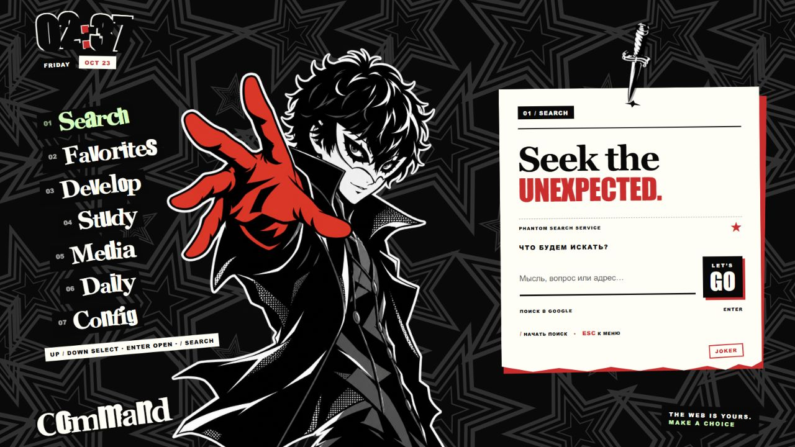

# PHANTOM START

Персональная стартовая страница в стиле Persona 5: чёрно-серые звёзды, персонажи для каждого раздела и записка, которую закрепляет падающий нож.



## Запуск

Скачайте репозиторий и откройте `index.html` в браузере. Сборка и установка зависимостей не нужны. Папка `assets` должна оставаться рядом с HTML-файлом.

Для локальной разработки можно запустить сервер из корня проекта:

```sh
python -m http.server 8877 --bind 127.0.0.1
```

Откройте `http://127.0.0.1:8877/`. После обновления файлов используйте Ctrl+F5.

## Возможности

- Search — поиск Google или переход по адресу сайта.
- Favorites, Develop, Study, Media — сохранённые ссылки и категории.
- Daily — дата, погода Алматы, локальные заметки и повтор календарной анимации.
- Config — редактирование сохранённых ссылок.
- Стрелки переключают разделы, `/` открывает поиск, Escape возвращает фокус в меню.
- Персонажи загружаются по мере обращения к разделам; завершённые анимации освобождаются.

Ссылки и заметки хранятся в localStorage текущего браузера. При переходе с файлового адреса на локальный сервер хранилище будет отдельным. Погода и поиск требуют подключения к интернету.

## Firefox

В `firefox-theme/userChrome.css` находится дополнительное оформление панелей Firefox. Оно устанавливается отдельно от стартовой страницы; существующий пользовательский CSS следует предварительно сохранить.

## Проверка

Через локальный сервер откройте `review/menu.html` и `review/motion.html`. Проверочные страницы используют изолированное хранилище и не меняют пользовательские заметки и ссылки. Проверено в Chromium; проверка в нативном Firefox пока не проводилась.

Проект представляет собой неофициальную фанатскую кастомизацию Persona 5 и не связан с Atlus или Sega.
